# ExtremeCompressor user guide

This guide covers version 0.1.0 for Windows. It tells you how to use every part of the app, step by step.
The pictures show the dark theme. The sample files in the pictures are made-up test data, so the numbers
are only examples.

**Contents**

1. [What it is, and what it promises](#1-what-it-is-and-what-it-promises)
2. [Install and first run](#2-install-and-first-run)
3. [The window at a glance](#3-the-window-at-a-glance)
4. [The Compress tab](#4-the-compress-tab)
5. [The Restore tab](#5-the-restore-tab)
6. [The Activity tab](#6-the-activity-tab)
7. [The Settings tab](#7-the-settings-tab)
8. [Notifications, tray and taskbar](#8-notifications-tray-and-taskbar)
9. [The Explorer right-click menu](#9-the-explorer-right-click-menu)
10. [Step-by-step tasks](#10-step-by-step-tasks)
11. [The command line](#11-the-command-line)
12. [Keyboard shortcuts](#12-keyboard-shortcuts)
13. [Troubleshooting and FAQ](#13-troubleshooting-and-faq)
14. [Known limits](#14-known-limits)
15. [Words explained](#15-words-explained)

---

## 1. What it is, and what it promises

ExtremeCompressor makes your files smaller. You give it files or folders. It makes one archive file
(extension `.excmp`) that holds all of them.

It does not use one method for everything. It looks at every file first. It sends each file to the method
that suits that kind of data. Files that cannot get smaller (for example most videos) are stored as they
are, and the app tells you why.

**The promises**

- **Lossless.** When you restore, every file comes back exactly as it was, byte for byte. Nothing is ever
  made "a little worse" to save space.
- **It checks itself.** Before an archive is accepted, the app restores the whole archive into a temporary
  folder and compares a fingerprint (SHA-256) of every file with the fingerprint taken from the original.
  If one byte differs, the job fails. It never says "done" on trust.
- **Your originals are never changed.** The app only reads them.
- **No half-written archives.** The archive is first written to a file ending in `.tmp`. It is renamed to
  its real name only after the check above passed.
- **A smaller size is never forced.** If the data cannot shrink, the app says so before you start.

Lossy shrinking (re-encoding video or audio) is **not** available. The app has a note about a future
"Shrink mode". It does not exist yet.

---

## 2. Install and first run

### 2.1 Install

1. Run the installer file named like `ExtremeCompressor-0.1.0-setup.exe`.
2. Windows SmartScreen may warn about an unknown publisher. The installer is not signed yet. If you
   trust the file, choose **More info**, then **Run anyway**.
3. The installer works for your user only. It does not need administrator rights.
4. On the options page you can tick:
   - **Add "Compress with ExtremeCompressor" to the Explorer right-click menu** (ticked by default)
   - **Create a desktop shortcut** (off by default)
5. Finish. You can launch the app from the last page, or from the Start menu.

To remove the app, close it first, then use **Windows Settings > Apps**. If the window is open, the
uninstaller refuses to run. That is on purpose.

> Running from the source code instead (for developers): `python run_gui.py` or `python -m gui`.
> See `README.md`.

### 2.2 First run

The first time the window opens, a blue notice appears at the top:

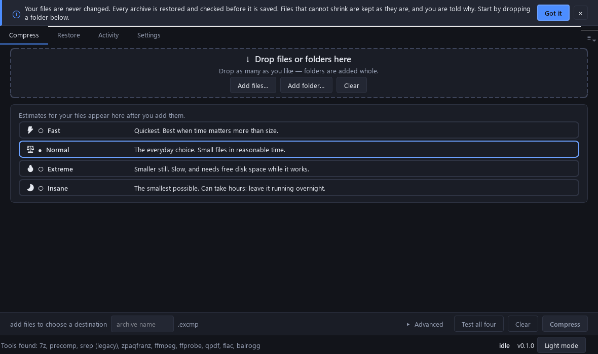

*The notice says your originals are never modified, and that files that cannot shrink are stored
byte-for-byte. Press **Got it** (or the x) to close it. It does not come back.*

### 2.3 The tools the app uses

The app does not compress by itself. It drives other programs. The status strip at the bottom starts with
"Tools found: ..." and **Settings > Tools on this machine** lists them all with their paths.

| Profile | Needs |
|---|---|
| Fast | Nothing extra (built in) |
| Normal | 7-Zip |
| Extreme | 7-Zip and Precomp |
| Insane | 7-Zip, Precomp and zpaqfranz |

If a tool is missing, the profile still works as well as it can and tells you what changed. For example:
"zpaqfranz missing — runs as Extreme". The list may also show helper tools for special file types. A
tool marked **(legacy)** is only used to open old archives. It is never used to make new ones.

### 2.4 Where the app keeps its things

- **Settings and window size**: remembered by Windows for your user. They are saved when you close the window.
- **Temporary files and records**: the folder `C:\Users\<you>\.excmp\`. It holds:
  - `tmp\` - scratch space while jobs run (see [13.5](#135-where-do-temporary-files-go-and-how-do-i-free-space))
  - `history.json` - the list shown under **Past jobs**
  - `calibration.json` - what the app learned about the speed of your machine

> Do not delete the whole `.excmp` folder if you also publish releases of the app. A file named
> `update-signing.key` can live there. It has no copy anywhere else.

### 2.5 Updates

The app can look for a newer version once a day. See [10.9](#109-update-the-app) and
[10.10](#1010-turn-off-the-daily-update-check).

---

## 3. The window at a glance

There is one window. There are no pop-up dialogs. Questions and warnings appear in a strip at the top
(see [6.6](#66-the-banner-the-strip-at-the-top)).

**Four tabs:** Compress, Restore, Activity, Settings.

**The "≡" button** at the right end of the tab bar opens a menu:
Add files…, Add folder…, Open archive (Extract)…, Pause/resume queue, Clear finished jobs,
Toggle light/dark theme, About ExtremeCompressor, Exit.

**The status strip** at the very bottom, from left to right:

| Part | What it shows |
|---|---|
| Tools found: ... | Which tools were found. It is cut short when the window is narrow. The full list is in Settings and in About. |
| Job text | What the queue is doing, for example "MyGame · ~4 min left", "1 job waiting", "idle". **Click it to open the Activity tab.** |
| Small bar | Progress of the running job. Only visible while a job runs. |
| v0.1.0 | The version. |
| Light mode / Dark mode | Switches the colours. Your choice is remembered. |

**About card.** Press **F1** (or choose About in the "≡" menu). A card appears on the Compress tab with the
version, what the app does, the tools found and the shortcuts. Press **Close** or F1 again to hide it.

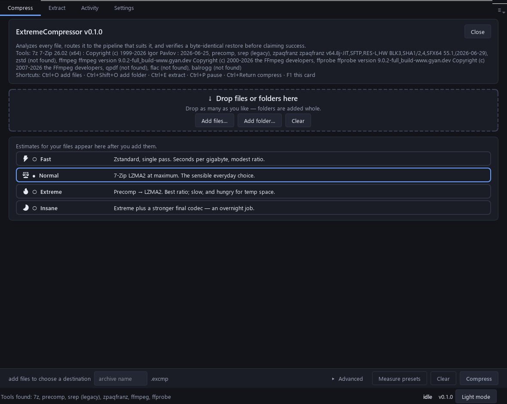

**Command search.** Press **Ctrl+K**. A small box opens. Type a few letters of a command (for example
`oa` finds "Open archive (Extract)…"). Use the arrow keys and **Enter**. **Esc** closes it.

---

## 4. The Compress tab

This is where you decide what to compress and how. The flow is: drop, read the analysis, pick a profile,
press Compress.

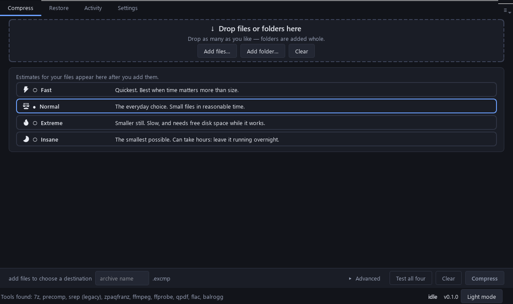

*Empty Compress tab: the drop area on top, the four profiles below, the action bar at the bottom.*

### 4.1 The drop area and the pending list

- **Drop files or folders here.** Drag files and folders from Explorer onto the dashed area. You can drop
  as many as you like. A folder is added whole, with everything in it. There is no filter by file type.
- **Add files…** opens a file chooser ("Select files to compress").
- **Add folder…** opens a folder chooser ("Select a folder to compress").
- **Clear** removes everything you added.

When something has been added, the big area shrinks to one line, for example **3 items - 371.5 KB**. It
grows again while you drag something over it.

**That line is a button.** Click it to show the **pending list**: the names of what is waiting.

- Select a name and press **Del** to remove just that item.
- Or right-click a name and choose **Remove** or **Show in Explorer**.

Adding more files later keeps what is already there. A path that is already in the list is ignored.

### 4.2 The analysis card

As soon as you add something, a card reads your files. It shows a thin bar while it works, with
"looking for files…" and then "scanning 40/120". A big folder on a slow disk can take minutes. The bar
moves, so it is not stuck.

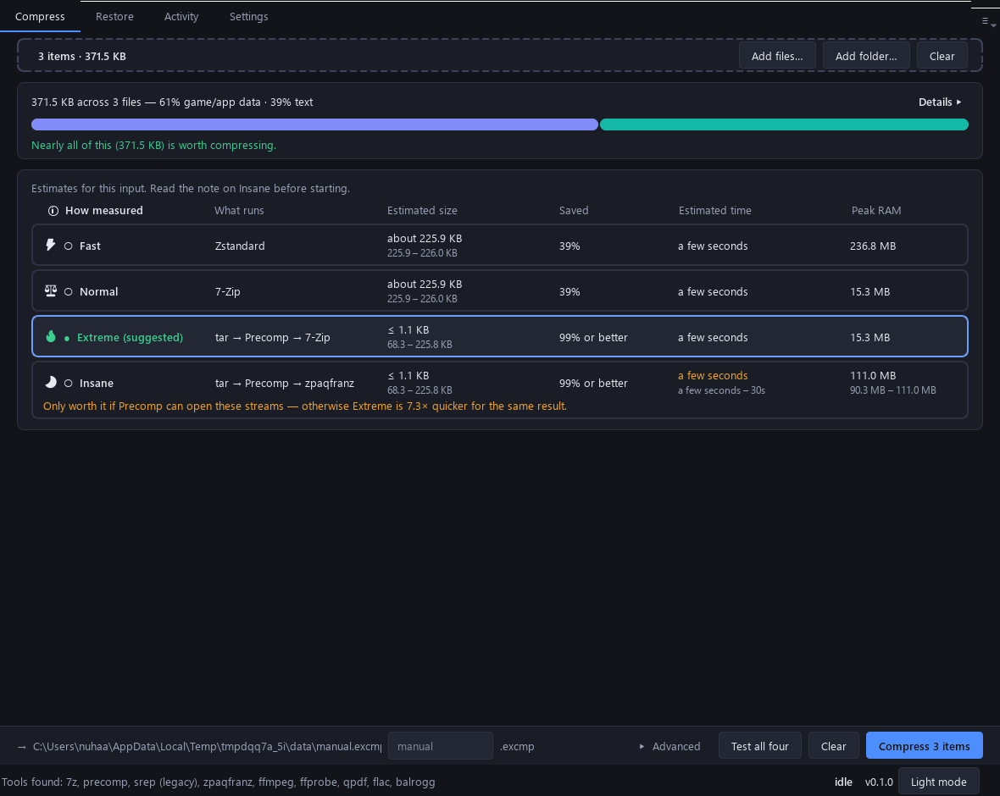

When it is done, the card shows:

- **A headline**, for example "371.5 KB across 3 files — 61% game/app data · 39% text". It names the total size and the
  biggest kinds of data. The kinds the app uses are: video, audio, images, archives, programs, text and
  game/app data.
- **A coloured bar** with one colour per kind.
- **One sentence about what can shrink.** Green means most of it can. Amber means most of it is already
  compressed. Examples of what it can say:
  - "Nearly all of this (371.5 KB) is worth compressing."
  - "81% of this is already compressed and will be stored bit-exact; only 600 MB can actually shrink."
  - "Every byte here is already compressed — lossless gain is ~0%."
  - It also names Ogg audio (repacked losslessly, typically 4-15% smaller) and JPEG photos (repacked
    losslessly, typically 21-33% smaller) when you have them.
- **Details** (button at the right). It opens more:
  - the colour legend,
  - a **treemap**: a picture where each rectangle's area is one kind of data, so you can see what is big,
  - a note about Shrink mode (not available yet). If at least 40% of your data is video or audio that
    cannot shrink, it adds: "Only re-encoding makes that smaller — Shrink mode is coming in a later
    release, and it will always be opt-in."
  - **Warnings**, one per line starting with a dot. For example a file that could not be read (an open Excel
    file, for instance). Such a file does not stop the analysis.

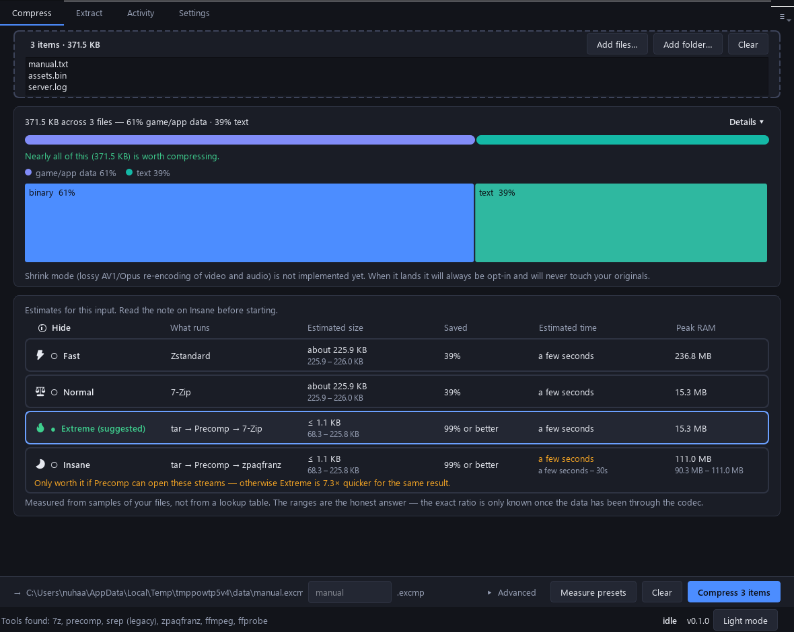

### 4.3 The profile chooser

The chooser is the table under the card. It has **four profiles**. You pick one. A filled dot means
selected. Pick by clicking a row, or press **Tab** to reach a row and then **Enter** or **Space**.

| Profile | What runs | Good for |
|---|---|---|
| **Fast** | Zstandard (level 12), single pass | The quickest by far: measured about 13 MB a second from start to finish on big files, with the final check included (thousands of tiny files are slower, because every file costs time). Modest ratio. Use it when data is already compressed (video, photos, installers) or when you are in a hurry. |
| **Normal** | 7-Zip, LZMA2 at maximum | The sensible everyday choice. |
| **Extreme** | tar, then Precomp, then 7-Zip | Best ratio for game and program data that hides compressed parts inside. Slow. Needs a lot of temporary disk space. From version 0.1.1 it also keeps only one copy of content that repeats far apart (copies and versions of the same big file), which can nearly halve a folder that holds versions or backups. |
| **Insane** | Extreme, but with a stronger last step (zpaqfranz) | The smallest archives this app makes. An overnight job on a laptop. Without zpaqfranz it runs as Extreme. |

**The app suggests one.** The suggested row is green and says "(suggested)". Hover over it to read the reason.
The rules of thumb it follows:

- Almost everything is already compressed: **Fast** (the slow profiles would spend hours to save about 0%).
- A small job (64 MB or less): **Extreme**, because the time cost is small.
- A big job (8 GB or more) on a computer with 4 cores or fewer: **Normal**, because Extreme would run for hours.
- Lots of compressible data and Precomp installed: **Extreme**.
- Otherwise: **Normal**.
- Last check: if samples of your files say a cheaper profile lands within a few points of the suggested one,
  the app suggests the cheaper one and says why. (It does not do this when the estimate is only a ceiling,
  because Precomp may find more than the quick check can see.)

The suggestion is only a suggestion. You can pick any row. If you picked a profile last time for the same
kind of data, the app pre-selects it and says so: "Using Fast, which you picked last time for mostly video files."

**The columns.** Before you add files, each row only has a one-line description. After the analysis, the row
shows numbers for **your** files:

| Column | Meaning |
|---|---|
| **Profile** | Name. The "ⓘ How measured" button here shows or hides a note: "Measured from samples of your files, not from a lookup table. The ranges are the honest answer — the exact ratio is only known once the data has been through the codec." |
| **What runs** | The tools in order, for example "tar → Precomp → 7-Zip". If a tool is missing, an orange note says what changes. |
| **Estimated size** | The expected size of the archive. Under it, a range (low - high). |
| **Saved** | How much smaller than the original. |
| **Estimated time** | How long the job should take on this machine. Under it, a range. |
| **Peak RAM** | The most memory the job should use while compressing. |

**How to read the estimate.**

- **"about 225.9 KB"** is a good guess. The small line under it is the likely range.
- **"≤ 1.1 KB"** (the sign means "at most") is a **ceiling**, not a promise. Precomp may open hidden
  streams that the quick check cannot see. The real size lies somewhere in the range under it. The
  estimate treats the number as an upper limit.
- **"99% or better"** goes with a ceiling. It means "at least this much saved, probably less". The text never
  says 100%, because an archive is never empty.
- **Time** is words ("a few seconds", "about 3 hours") with a range under it. It is a forecast. The app also
  learns from your finished jobs and gets better on your machine.
- **Orange note on a row**, for example "Only worth it if Precomp can open these streams — otherwise Extreme is
  7.3× quicker for the same result." It means a cheaper profile may give nearly the same size in much less
  time. Read it before you choose that row.
- **Long jobs.** If the chosen profile is estimated at 45 minutes or more, a warning appears: "This job is about
  N minutes on this machine - worth starting before you step away." At 90 minutes or more it says hours.

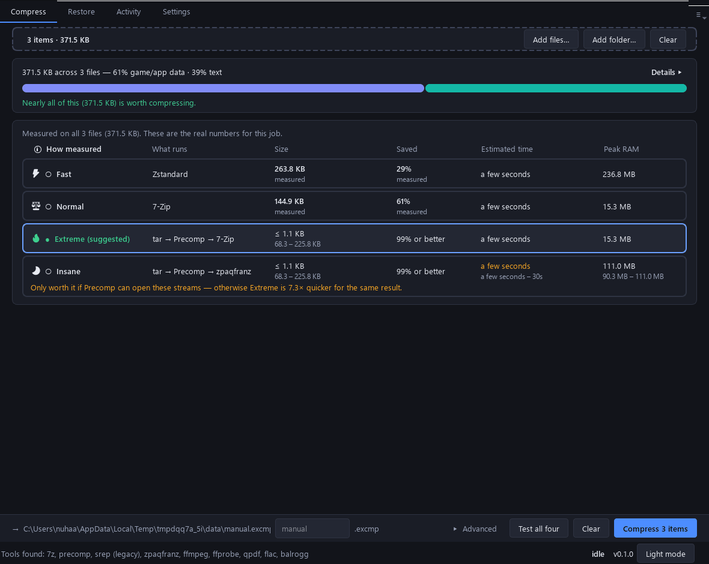

### 4.4 Test all four (real numbers instead of estimates)

An estimate can be wrong. **Test all four** (button in the bottom bar) runs the real profiles on a
**sample** of your files and reports what each one really saved.

1. Add your files and wait for the analysis to finish. (The button is grey until then.)
2. Press **Test all four**. The profiles run one after another as short jobs. Their test archives are
   deleted right after the size is read.
3. As each profile finishes, its **Saved** cell changes to the measured percentage, with the word
   "measured" under it. The line above the table says what was measured, for example "Measured on 13
   files — 55.7 MB, 4.2% of this input. Real ratios for those bytes, not a forecast for the rest."
4. If your sample is the **whole** input, the size column is measured too, and its heading changes from
   "Estimated size" to "Size".
5. The button turns into **Stop measuring** while it runs. Press it to stop. What finished stays.

Good to know:

- A sample **ranks** the profiles. It does not predict the final size of the whole job.
- Time is never measured. It stays an estimate.
- If the smallest file is bigger than the sample size (about 100 MB), a notice asks: "The smallest file here
  is ..., so there is no small sample to take — measuring will compress all of it, N times." Choose
  **Measure anyway** or **Not now**.
- If one profile cannot be measured, a notice says which and why. No number is invented for it.
- Changing the files (adding, removing, Clear) throws the measured numbers away. They belong to those files.

### 4.5 The bottom bar and the Advanced panel

The bar at the bottom never scrolls away.

| Part | What it does |
|---|---|
| **→ C:\...\name.excmp** | The exact file that will be written. If that name is taken, the app adds " (2)" and shows it here. Before you add files it says "add files to choose a destination". |
| **archive name** box + **.excmp** | Type a name for the archive. Leave empty to use the name of the first item. Only a plain name is allowed, with no folders in it. Otherwise "invalid name" appears in red and Compress is disabled. The extension label follows the Format box (.excmp, .7z or .zip). |
| **Advanced** | Opens or closes the Advanced panel (below). |
| **Test all four** / **Stop measuring** | See 4.4. |
| **Clear** | Removes everything you added. |
| **Compress** / **Compress 1 item** / **Compress N items** | Puts the job in the queue. Ctrl+Return does the same. |

By default the archive is written **next to the first item** you added. Change that in Advanced > Output
folder.

When you press Compress, the Compress tab empties, ready for the next folder. Your job runs on the
Activity tab. Several jobs wait in line and run one at a time.

### 4.6 Advanced panel

Press **Advanced** to open it above the bottom bar. Everything here is for **this job only** and has a safe
default. Nothing in this panel is remembered after you close the app.

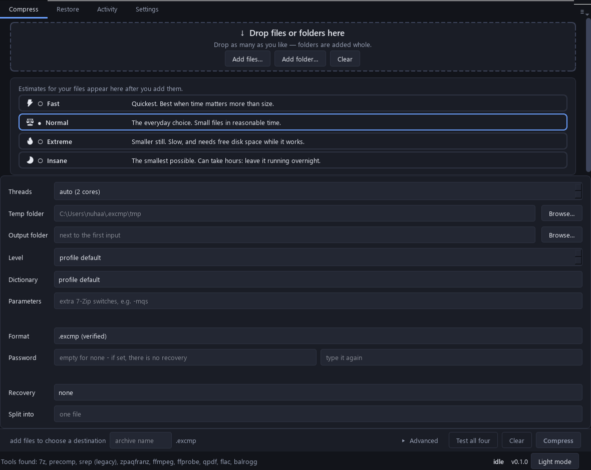

| Field | What it does |
|---|---|
| **Threads** | How many worker threads. "auto (2 cores)" gives one per physical core. Lower it to keep the computer usable during a long job. |
| **Temp folder** + **Browse…** | Where scratch files go while the job runs. Precomp can swell data 2-5 times in the middle of the work. Point it at a drive with room. The box starts empty and shows, greyed, the folder **Settings > Temporary folder** names. Type a folder here to use it for the next job only. |
| **Output folder** + **Browse…** | Where the archive is written. Empty means next to the first input. **The folder must already exist.** |
| **Level** | 0-9. "profile default" lets the profile decide. Higher is smaller and slower. |
| **Dictionary** | The size of the 7-Zip (LZMA2) memory window. Bigger finds repeats that are further apart, but costs about 13 times its size in memory. The list stops where your machine would run out. |
| **Parameters** | Extra 7-Zip switches, for example `-mqs`. Method switches only. `-p`, `-o`, `-w` and `@listfile` are refused. A refused line stops the job with a notice: "That Parameters line was not accepted: ...". |
| (grey line) | After you pick a Dictionary: "About X of memory while compressing, Y to extract." |
| **Format** | **.excmp (verified)**: the app's own archive, with a fingerprint list so the restore can be re-checked at any time. **.7z (compatible)** and **.zip (compatible)**: ordinary archives that any program opens. They are still checked when written, but carry no fingerprint list, so **Check without restoring** cannot check them later. They cannot be password-protected. |
| **Password** + **type it again** | Encrypts the whole archive, including file names. See 4.7. |
| **Recovery** | **none**, or **1% / 3% / 5% / 10% of the archive**. See 4.8. |
| **Split into** | Cuts the finished archive into numbered parts of this size, for example `100m` or `4g`. See 4.9. Empty means "one file". |

Level, Dictionary and Parameters are 7-Zip settings. Leave them alone unless you know why you want them.

### 4.7 Passwords (encryption)

1. Open **Advanced**.
2. Type the password in **Password**, and again in **type it again**.
3. Compress as usual.

What you must know:

- It encrypts the **whole** archive, file names included, with Argon2id and AES-256-GCM (strong, standard
  methods).
- **There is no backdoor, no reset and no recovery.** If you lose the password, the data is gone. The
  panel warns you while you type.
- If the two entries differ, a notice stops the job: "That job could not be started: the two passwords do
  not match - type the same one twice".
- The password is wiped from the fields as soon as the job is queued. The next job is **not** encrypted
  unless you type a password again.
- The password is never written to the history file.
- A password cannot be combined with the .7z or .zip format. The job fails and says to use .excmp.
- A password-protected `.excmp` archive opens in the Restore tab: press **Restore** or **Check without restoring**
  and the notice asks for the password ([10.5](#105-open-an-encrypted-archive)). The command line works too.

### 4.8 Recovery records (repair data)

A recovery record is extra data stored in separate files next to the archive. If a few bytes go bad later
(a bad disk sector, a broken download), the app can **repair** the archive instead of only telling you it
is damaged.

- Choose a percentage under **Recovery**. It costs about that much extra disk space.
- The extra files end in `.par2` (for example `name.excmp.par2` and `name.excmp.vol0+1.par2`). Keep them
  **in the same folder** as the archive, always.
- Repair is done on the command line: `excmp repair`. See [10.6](#106-repair-a-damaged-archive).
- The records have to be made when you compress. They cannot be added later.
- Small archives are the ones most likely to be lost completely. If you are unsure, 5% is a fair choice.

### 4.9 Splitting into parts

Choose a size under **Split into**, for example `4g` for a FAT32 drive or `100m` for a flaky upload.

- The app first writes and checks the whole archive. Then it cuts it into `name.excmp.001`, `.002`, ...
- A small file `name.excmp.volumes.sha256` lists a fingerprint for each part, so a bad transfer can name
  the part to download again.
- The whole archive file is also kept. Delete it yourself if you only want the parts.
- To restore, you only name the `.001` part. The app finds the others. Keep all parts in one folder.

---

## 5. The Restore tab

Use it to restore an archive, to check one, and to look inside. It opens `.excmp` archives and also other
people's archives.

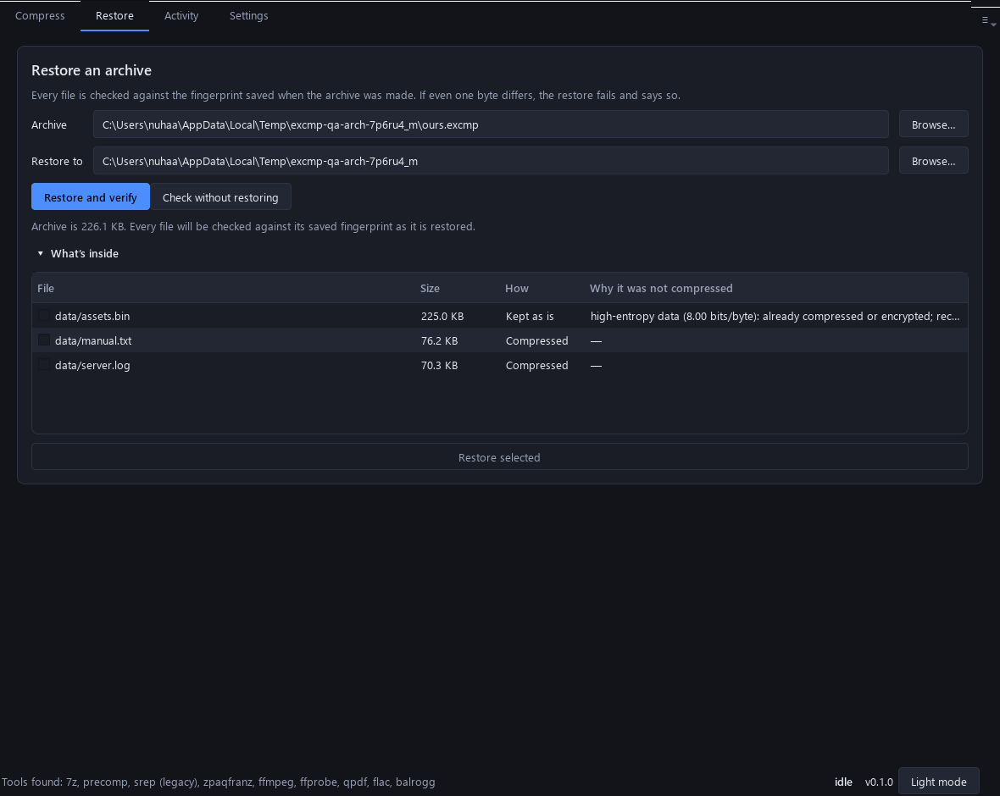

| Part | What it does |
|---|---|
| Intro text | Changes with the archive. For ours: every file is checked against the fingerprint saved when the archive was made, and one different byte fails the restore. For others: no fingerprints exist, so files can be restored but not checked. |
| **Archive** + **Browse…** | The archive. Type or paste a path, use Browse…, or **drop a file on the tab**. The file chooser filter is "Archives (*.excmp *.zip *.7z *.rar *.tar *.gz *.tgz *.bz2 *.xz *.zst *.iso *.cab *.msi *.wim *.lzh *.arj)". Choose "All files" for other names, such as a `.001` part. |
| **Restore to** + **Browse…** | The destination folder. Filled in for you. If everything in the archive is inside one top folder, it suggests the folder next to the archive. Otherwise it suggests a new folder named like the archive. You can change it. |
| **Restore and verify** | Restores every file to the destination. For our archives, it also re-checks every SHA-256. |
| **Check without restoring** | Restores to a temporary folder, checks every file, then deletes it again. **Nothing is written to your destination.** Grey for other people's archives (they have no fingerprints). |
| Status line | For example: "Archive is 226.1 KB. Every file will be checked against its saved fingerprint as it is restored." |
| progress bar | Shows while a restore runs. |
| **What’s inside** | Opens a list of the archive's contents, without extracting anything. |
| **Restore selected** | Restores only the ticked files (see below). |

**What’s inside, for an .excmp archive.** Columns:

| Column | Meaning |
|---|---|
| File | The path inside the archive. Hover over a name to see its SHA-256. |
| Size | Original size. |
| How | **Compressed**, or **Kept as is** (not changed because it could not shrink). |
| Why it was not compressed | The reason a file was not compressed, for example "high-entropy data (8.00 bits/byte): already compressed or encrypted; recompression would gain ~0%". Shows "—" for compressed files. |

**For somebody else's archive** the columns are File, Size, **Packed** and **Modified**. A caption explains
that these are the archive's own numbers and that the CRC-32 (hover over a name) is an error check, not
a SHA-256. A big archive may be cut at its first entries, and the caption says so.

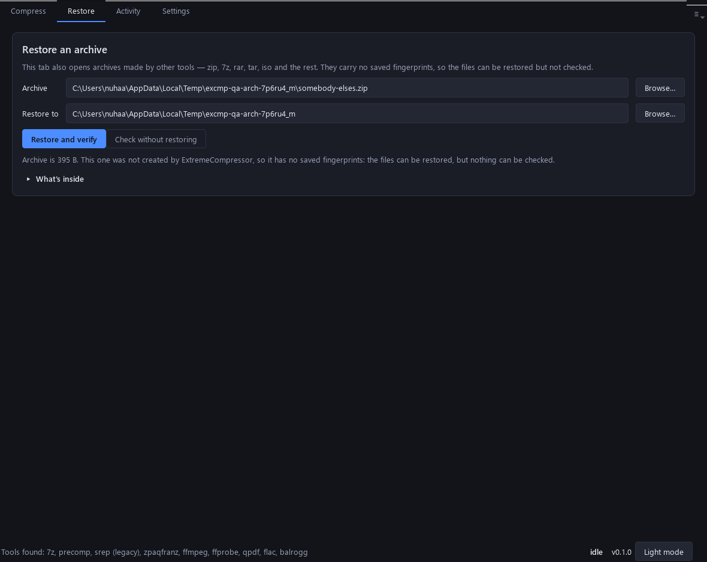

**Restore selected.** Tick the boxes in front of the files you want. The button changes to "Extract 1
selected". Press it. If the archive is **solid** (all files compressed as one block), reaching a single
file means decompressing much of the block. The app tells you first, with a notice: "N file(s) selected,
but this archive is solid: reaching them replays X of compressed data." Choose **Extract anyway** or
**Cancel**. A destination must be set first, or the notice says "Choose where the files should go first."

**Password for other people's archives.** If their file names are encrypted, a notice asks for the
password:

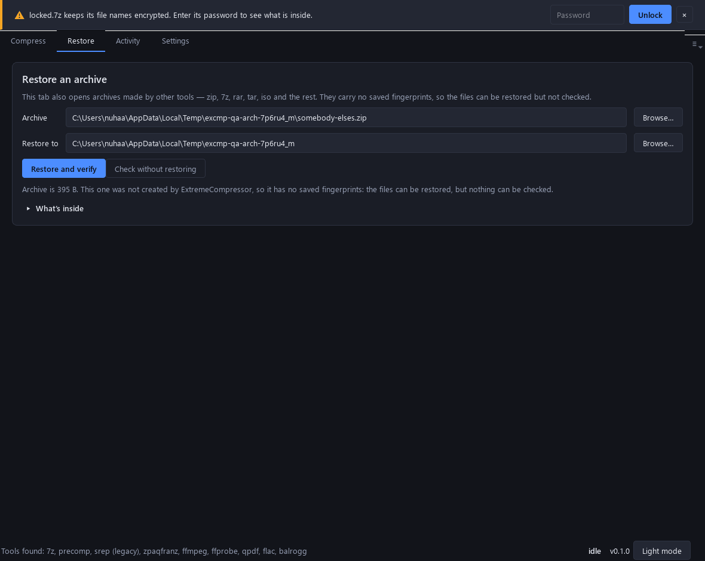

Type it in the box, then press **Unlock** (or Enter). The list then opens. The password is kept only for
that archive.

> A password-protected `.excmp` archive is recognised: the status line says so, and pressing **Restore** or
> **Check without restoring** asks for the password in the notice (the list under **What’s inside** is not
> available for it).

**After a restore.** The Activity tab shows "Restored N files" and "N SHA-256 hashes verified —
byte-identical to the originals". The Restore tab status says "Restored N file(s); N hash(es) verified
byte-identical." For somebody else's archive the wording is different on purpose: the files came out,
but nothing could be checked.

---

## 6. The Activity tab

Everything that is running or finished is here.

### 6.1 The header

- **Queue** and a short status text ("MyGame · ~4 min left").
- **Clear finished**: removes finished, failed and cancelled jobs from the list. They move to **Past jobs**.
  Grey when there is nothing finished.
- **Pause queue** / **Resume queue**: see 6.4. Grey when nothing is waiting.
- The tab title shows how many jobs are waiting or running: **Activity (2)**.

### 6.2 The result panel

When a job finishes, a panel appears above the queue. It disappears when you add new files or start a new job.

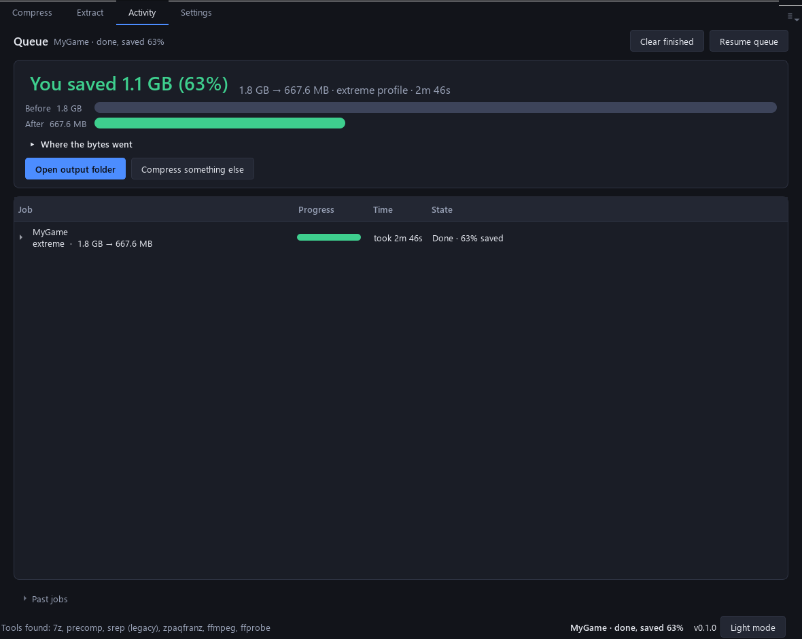

For a **compression**:

- **Headline**: "You saved 1.1 GB (63%)" in green. Amber if nothing was saved. Right-click it and choose
  **Copy summary** to copy the text.
- **Subline**: "1.8 GB → 667.6 MB · extreme profile · 2m 46s".
- **Before / After bars**.
- **Where the bytes went** (open it with the arrow): for each kind of data, how much was compressed and how
  much was stored as it was. The archive is one solid block, so the app does not invent a size for each
  file. Only the total is real.
- **Why some files didn't shrink**: the files that were stored, each with its reason. It shows three. **Show
  all N** shows the rest. This list always shows, because it is the answer to "why only 3%?".
- **Open output folder**: opens Explorer at the archive.
- **Compress something else**: closes the panel and clears the Compress tab.

After a **restore**: "Restored N files". After **Check without restoring**: "Verified N files", with the sentence that
nothing was written to disk. After a **failure**: "That job failed" in red, with the reason.

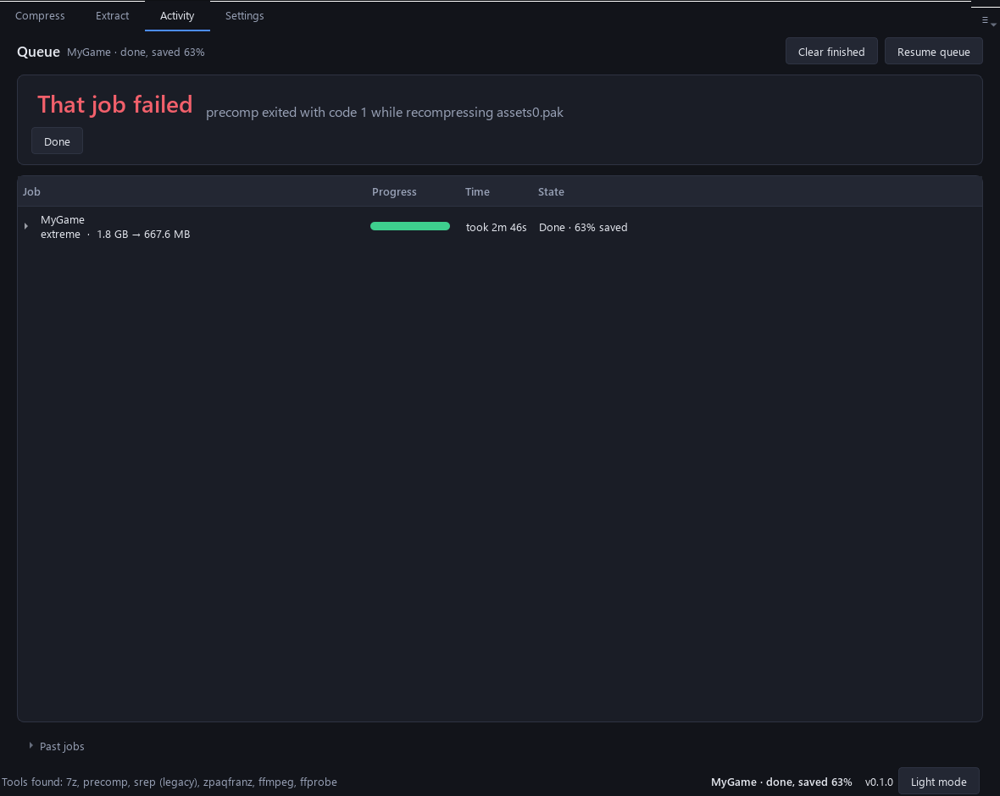

*Failed job: the red headline, and the reason next to it. Open the row's log for the tool's own words.*

### 6.3 The queue table

Jobs run **one at a time**, in the order you added them. Columns:

| Column | Meaning |
|---|---|
| **Job** | The name, with a second line: the profile (or "extract" / "verify") and the size. When done: "extreme · 1.8 GB → 667.6 MB". Hover to see all input paths. |
| **Progress** | A bar. It stops at 95% until the job really finishes, so it never sits at 100% and lies. |
| **Time** | Time left while running ("~4 min"), "took 2m 46s" when done, "-" when no time can be given. |
| **State** | Queued, Running, Paused, Done, Failed or Cancelled. While running it adds the stage, see below. When done: "Done · 63% saved". |
| **x** (red) | Cancels this job. Only on jobs that are not finished. |

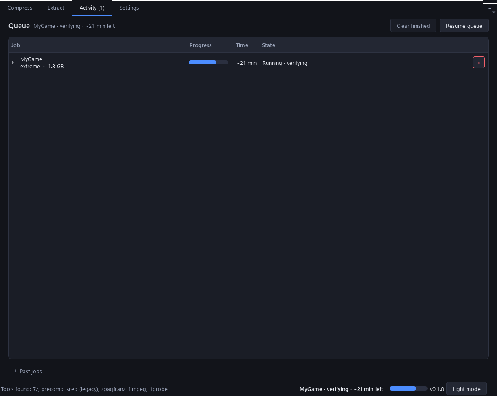

*In this picture the button says "Resume queue" only because the test picture was taken with the queue
paused. Normally it says "Pause queue" while a job runs.*

**Stages you will see after "Running":**

- **verifying**: the app restores the whole archive into the temp folder and checks every fingerprint. This
  is the self-test. It can take a large part of the time, up to about 40% of an Insane job.
- **verifying, past estimate**: it is taking longer than predicted. This is normal for big jobs. No time
  left is shown, because the app does not know.
- **repacking media**: Ogg audio and JPEG photos are being repacked losslessly.
- **finishing**: writing the final file, encrypting, making recovery records or splitting.

**The arrow at the left of a row** opens the tool's own text output (the log). It is the first place to
look when something fails. A failed job opens its log by itself.

**Right-click a row** (or press the menu key or Shift+F10) for:

- **Cancel**
- **Show log**
- **Open output folder** (only when the job is done)
- **Copy output path**
- **Copy as command**: copies the `excmp compress ...` line that repeats the job (compress jobs only). A
  password is never copied. If the job had one, the line contains `--password` and the command will ask.

### 6.4 Pause

Press **Pause queue**. The running job **finishes its current stage** and then holds. Nothing is thrown away.
New jobs do not start. Its state reads "Paused" and the button reads **Resume queue**. Press that to go
on. Ctrl+P does the same.

### 6.5 Cancel, and closing the window

- **Cancel** a job with the red x. The job stops. Your originals are untouched. No finished-looking archive
  is left, because the archive only gets its real name after it has been checked.
- **Closing the window while a job runs** shows a notice instead of closing: "A job is still running.
  Closing will cancel it — your originals are untouched and no partial archive is left behind." Choose
  **Close anyway** or **Keep it running**.

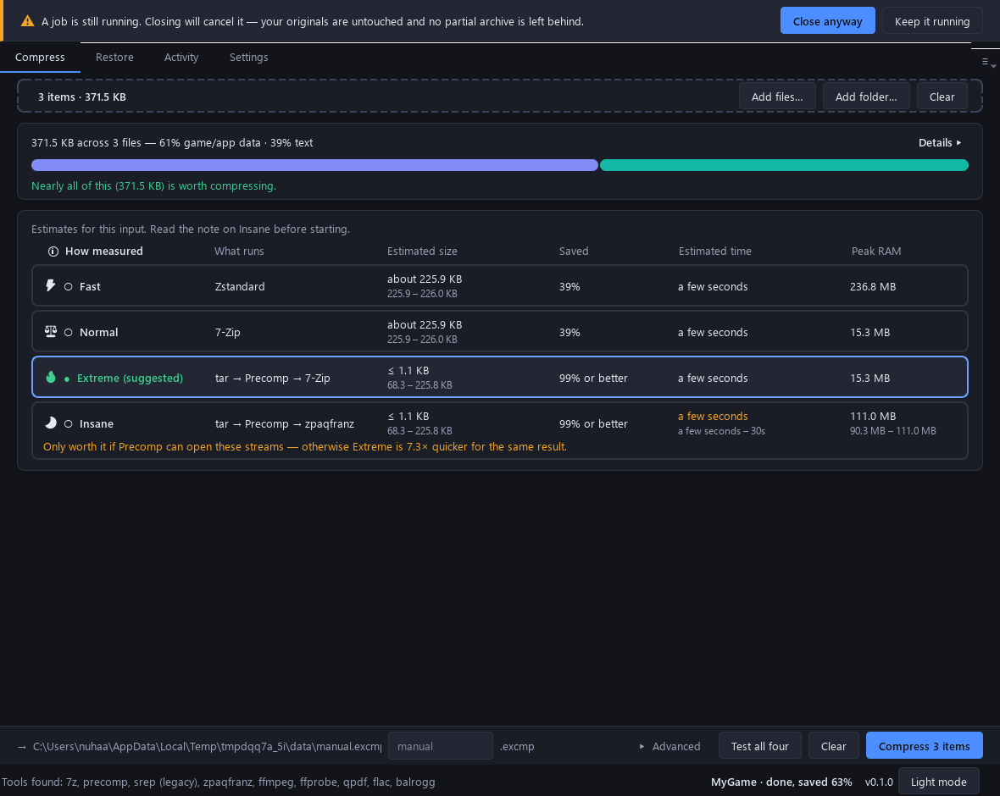

### 6.6 The banner (the strip at the top)

This strip is the only way the app asks you something. It has an icon, one sentence and buttons. It
appears above the tabs. The x closes it.

| Colour | Meaning |
|---|---|
| Blue (note) | Information, for example the first-run notice or "Version 0.2.0 is available." |
| Orange (warning) | Something to read before you go on, for example a long job or a bad Parameters line. |
| Red (error) | Something went wrong. |

Warnings are never replaced by an update notice.

### 6.7 Past jobs

Press **Past jobs** at the bottom of the Activity tab to open the history. It lists jobs you cleared with
**Clear finished**, newest first, up to 200.

Columns: **Archive**, **Profile**, **Size**, **Saved**, **Took**, **When**, and a **Compress again** button.
Failed jobs are kept too (hover over the row for the reason). Encrypted jobs say "(encrypted)".

- **Compress again** goes to the Compress tab with the same inputs, the same profile and the same split size.
  Check **Advanced** for the other settings. If the job was encrypted, a notice says to type the password
  again, because it was never saved. If an input is gone, a notice says which one.
- **Forget all** deletes the list. The archives are not touched.

---

## 7. The Settings tab

Each row has a title, a line that explains it, and its control on the right. **Settings are saved when you
close the window.**

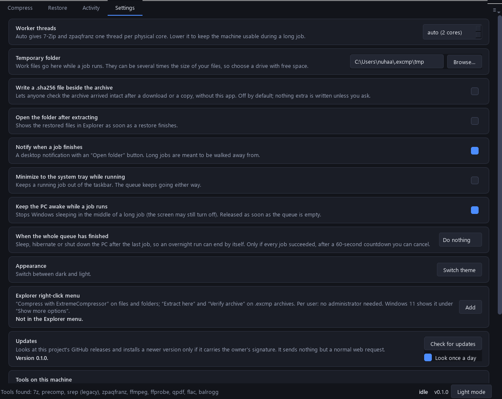

| Setting | What it does | Default |
|---|---|---|
| **Worker threads** | Threads for 7-Zip and zpaqfranz. "auto (2 cores)" is one per physical core. Lower it to keep the machine usable. Used when Advanced > Threads is on auto. | auto |
| **Temporary folder** + **Browse…** | Where work files go while a job runs. They can be several times the size of your files, so choose a drive with free space. Every job uses it unless you type another folder in **Advanced > Temp folder** (that is for one job only). | your user folder, `.excmp	mp` |
| **Write a .sha256 file beside the archive** | Writes `name.excmp.sha256` next to each new archive. Anyone can check the archive with `sha256sum` or QuickSFV, without this app. | off |
| **Open the folder after extracting** | Opens Explorer on the restored files as soon as a restore ends. | off |
| **Notify when a job finishes** | A Windows notification when a compression ends. | on |
| **Minimize to the system tray while running** | When you minimize while a job runs, the window hides to the tray. The queue keeps going. | off |
| **Keep the PC awake while a job runs** | Stops Windows sleeping in the middle of a long job (the screen may still turn off). Released as soon as the queue is empty. | on |
| **When the whole queue has finished** | **Do nothing**, **Sleep**, **Hibernate** or **Shut down** after the last job, so an overnight run can end by itself. It only happens if every job succeeded, and after a 60-second countdown in the banner that you can **Cancel** (or **Do it now**). | Do nothing |
| **Appearance** > **Switch theme** | Dark or light. | dark |
| **Explorer right-click menu** > **Add / Remove / Repair** | See [9](#9-the-explorer-right-click-menu). | not added |
| **Updates** > **Check for updates** and **Look once a day** | See [10.9](#109-update-the-app). | on |
| **Tools on this machine** | The full list of tools found, with versions and paths. Notes: "legacy" (never used to make archives) and "update it" (an old version with a known problem). A tool that is built in says so. | - |

---

## 8. Notifications, tray and taskbar

- **Notification.** When a compression ends and **Notify when a job finishes** is on, Windows shows a
  notification: "Compression finished" with the name and "saved X (N%)". The text in Settings says it
  carries an "Open folder" button (in our test Windows warned that the button is not supported, so it may
  not show). If Windows has no notification support, a tray balloon is used instead. A finished
  extraction does not send a notification.
- **Tray.** With **Minimize to the system tray while running** on: minimizing while a job runs hides the
  window to the tray (near the clock). Click the tray icon to bring the window back.
- **Taskbar.** The taskbar button shows the job's progress as a green bar. It turns red on failure and
  yellow while the queue is paused.

---

## 9. The Explorer right-click menu

It lets you start from Explorer without opening the app first. It is for your user only and needs no
administrator rights.

**What it adds**

| Where | Entry | What happens |
|---|---|---|
| On any file or folder | **Compress with ExtremeCompressor** | The app opens on the Compress tab with the items added and analysed. You still choose a profile and press Compress. Select many items and right-click once: they all arrive in one window. |
| On a `.excmp` file (double-click too) | **Extract with ExtremeCompressor** | Opens the Restore tab with the archive filled in. You press Restore. |
| On a `.excmp` file | **Extract here** | Starts the restore at once. It goes to the suggested folder. If that would overwrite a name that already exists there, it uses a fresh folder next to the archive named `name (2)` instead. |
| On a `.excmp` file | **Verify archive** | Starts the check at once. |

On **Windows 11** the entries are under **Show more options**.

**Add or remove it**

- In the app: **Settings > Explorer right-click menu**. The button says **Add**, **Remove** or **Repair**,
  and the line under it says what is true now:
  - "Not in the Explorer menu." (button: Add)
  - "On: right-click a file or a folder." (button: Remove)
  - "Partly in the Explorer menu: some entries are missing." (button: Repair)
  - "On, but it starts a different copy of ExtremeCompressor." (button: Repair)
- Or from the command line: `excmp shell install`, `excmp shell uninstall`, `excmp shell status`.
- The installer can add it for you (a tick box on the options page), and the uninstaller removes it.

`.excmp` becomes "owned" by ExtremeCompressor only if no other program already owns it. Another
program's choice is left alone.

If the app is already open, a second start (from Explorer) hands its files to the open window and closes
itself. You never get two windows.

---

## 10. Step-by-step tasks

### 10.1 Compress a folder

1. Open the **Compress** tab.
2. Drag the folder onto the drop area. Or press **Add folder…** and choose it.
3. Wait for the analysis card. Read the headline and the sentence about what can shrink.
4. Look at the profile table. Hover over the green "(suggested)" row to read why it is suggested.
   Choose a different row if you want.
5. Check the line at the bottom: **→ C:\...\name.excmp**. That is where the archive will go. To change the
   name, type in the **archive name** box. To change the folder, open **Advanced** and set **Output
   folder** (the folder must exist).
6. Press **Compress**.
7. Open the **Activity** tab (or click the job text at the bottom). Watch the progress. At the end the result panel says
   "You saved ...".
8. Press **Open output folder** to see the archive.

### 10.2 Compress one file with the strongest setting

1. Open **Compress**. Press **Add files…** and choose the file.
2. Wait for the analysis.
3. Click the **Insane** row. If the table says "zpaqfranz missing — runs as Extreme", Insane is not
   available on this machine. You will get Extreme.
4. Read the **Estimated time**. If it is long, a warning appears. Insane can take hours.
5. Optional: press **Test all four** first to see real numbers for every profile.
6. Press **Compress** and leave the computer running. You can minimize the window.
   Turn on **Settings > Notify when a job finishes** to be told when it ends.
7. When it finishes, read the result panel. If the saving is small, see
   [13.2](#132-what-does-stored-as-is-mean).

### 10.3 Extract (restore) an archive

1. Open the **Restore** tab. (Ctrl+E also works.)
2. Drop the archive on the tab, or press **Browse…** next to **Archive**.
3. Check **Restore to**. Change it if you want another folder.
4. Press **Restore and verify**.
5. Watch the Activity tab. The result says "Restored N files" and "N SHA-256 hashes verified -
   byte-identical to the originals".
6. If you want Explorer to open the folder by itself, tick **Settings > Open the folder after extracting**.

To restore only some files: press **What’s inside**, tick the files, press **Extract N selected**.

For a split archive, choose the `.001` part. Keep all parts in one folder.

### 10.4 Verify an archive (prove it is still good)

Use this on an archive that has been sitting on a drive for a long time, or before you delete originals.

1. Open the **Restore** tab. Choose the archive.
2. Press **Check without restoring**.
3. The Activity tab ends with "Verified N files" and "nothing was written to disk".

It does a full restore into the temp folder and compares every SHA-256, then deletes the temp files. It
works for `.excmp` archives only. For the command line version, which can also compare the archive with
your original files, see [11](#11-the-command-line).

### 10.5 Open an encrypted archive

**In the window** (works for other people's encrypted archives, and to look inside ours):

1. Restore tab: choose the archive.
2. Press **What’s inside**. A notice asks for the password.
3. Type it and press **Unlock**.
4. Tick the files you want and press **Restore N selected**.

**For an encrypted `.excmp` archive made by this app**, choose it in the Restore tab and press **Restore** (or
**Check without restoring**). The status line says it is password-protected, and the notice asks for the password; it
is used for that one job and then forgotten. The command line does the same:

```
excmp extract secret.excmp -o restored --password
```

The command asks for the password. Nothing is shown while you type.

### 10.6 Repair a damaged archive

This works only if you asked for **Recovery** when you compressed, and the `.par2` files are still in the
same folder as the archive.

1. Open a command prompt in the folder that holds the archive.
2. Check first: `excmp verify name.excmp`. If it says OK, nothing is wrong.
3. Run `excmp repair name.excmp`.
4. The answer is one of:
   - "name.excmp is intact - nothing to repair"
   - "name.excmp is damaged but repairable - rebuilding..." then "repaired; the archive now matches its
     recovery records"
   - "no recovery records found beside name.excmp" - they must be made when compressing
   - "name.excmp is damaged beyond what its recovery records can rebuild"
5. After a repair, run `excmp verify name.excmp` to confirm the contents too.

### 10.7 Add the right-click menu

1. Open **Settings**.
2. Find **Explorer right-click menu**. The line under the title says "Not in the Explorer menu."
3. Press **Add**.
4. The line now says "On: right-click a file or a folder." and the button reads **Remove**.
5. Right-click a file in Explorer. On Windows 11, choose **Show more options** first. Look for
   **Compress with ExtremeCompressor**.

To take it away, press **Remove** on the same row.

### 10.8 Add or remove it from the command line

```
excmp shell install
excmp shell status
excmp shell uninstall
```

`install --no-associate` adds the entries but does not make `.excmp` open with the app.

### 10.9 Update the app

Updates come from the project's GitHub releases. The app installs an update only if it carries the owner's
signature. It checks the fingerprint of the download first. It sends nothing but a normal web request.

1. Open **Settings**. Find **Updates**.
2. Press **Check for updates**. The line under the title says "Checking…" and then one of:
   - "You have the latest version (0.1.0)."
   - "Version X is available." The button now reads **Download and install X**.
   - an error sentence if it could not check.
3. Press **Download and install X**. The line says "Downloading X…".
4. When it says "Version X is downloaded and verified.", the app starts the installer and closes itself. The
   button reads **Install now** if it did not (for example because a job was running).
5. If a job is running when the download ends, a notice says: "The update is downloaded and verified. Finish
   or cancel the running job, then press "Install now" in Settings."

The same offer can appear as a blue notice at the top: "Version X is available." with **Download and
install** and **Later**.

### 10.10 Turn off the daily update check

1. Open **Settings > Updates**.
2. Untick **Look once a day**.
3. Close the window (this saves the setting).

You can still press **Check for updates** whenever you want. The daily check runs a few seconds after the
window opens. A look happens at most once every 24 hours. A window left open asks every 6 hours whether a
look is due.

---

## 11. The command line

The command is `excmp`. If you installed the app, `excmp.exe` sits in the same folder as
`ExtremeCompressor.exe`. From the source code, use `python -m excmp` instead of `excmp`.

```
excmp --version
excmp <command> --help
```

General rules:

- A command that works returns **0**. A failure prints `error: ...` and returns **1**.
- `--json` (where offered) prints machine-readable output.
- `--temp FOLDER` sets the scratch folder. The default is `C:\Users\<you>\.excmp\tmp`.
- **Passwords are never typed on the command line.** `--password` takes no value. The command asks for it.
  It is also read from a pipe, for scripts: in PowerShell, `"secret" | excmp verify a.excmp --password`.
  In cmd.exe, write `echo secret| excmp ...` with **no space** before the `|`, or the space becomes part of
  the password.
- Profile names are `fast`, `normal`, `extreme`, `insane`. The default is `normal`.
- The output folder of `compress` must exist.

### analyze: look, do not compress

Shows each file's kind, entropy and the planned route. Entropy is a measure of how random the data is:
about 8 means it cannot shrink.

```
excmp analyze "D:\Photos" -p normal
excmp analyze "D:\Photos" --json
```

```
file                  category   entropy   size
data\f1.txt           text          3.18   195.3 KB
data\rand.bin         binary        8.00    48.8 KB

[pipeline] 3 file(s): profile 'normal' chain: sevenzip
[store] 1 file(s): high-entropy data (8.00 bits/byte): already compressed or encrypted; ...
```

### compress

```
excmp compress INPUT [INPUT ...] -o OUTPUT [options]
```

| Option | Meaning |
|---|---|
| `-p`, `--profile` | fast, normal, extreme, insane |
| `-o`, `--output` | The archive to write (required) |
| `--temp` | Scratch folder |
| `--json` | JSON result |
| `--level 0-9` | Compression level. Omit to let the profile decide. |
| `--dict SIZE` | 7-Zip dictionary, for example `64m` or `256m` |
| `--params=SWITCHES` | Extra 7-Zip method switches. Use an **equals sign**: `--params="-mqs -myx=9"` |
| `--password` | Encrypt (asks twice) |
| `--keyfile FILE` | A second factor next to the password. You must supply the same file again to open the archive. Needs `--password`. Losing it is as final as losing the password. |
| `--recovery [PCT]` | Write repair data. Without a number: 5% (small), 3% (medium) or 1% (large archives). |
| `--format excmp\|7z\|zip` | Archive type. The default is excmp. |
| `--split SIZE` | Cut into parts, for example `100m` or `4g` |
| `--sha256` | Also write `<archive>.sha256` |

```
excmp compress "D:\Projects\MyGame" -o "E:\Backups\MyGame.excmp" -p extreme --recovery 5
```

```
done: 634.8 KB -> 50.0 KB (92.12% saved) in 2.7s
note: 1 file(s) stored losslessly - high-entropy data (8.00 bits/byte): already compressed ...
wrote 2 recovery file(s) at 5% (+5.4 KB); repair with `excmp repair MyGame.excmp`
```

### extract

```
excmp extract ARCHIVE -o FOLDER [--only NAME ...] [--password] [--keyfile FILE] [--low-memory] [--json]
```

Works for `.excmp` (verified) and for any archive 7-Zip opens (not verified, since it has no fingerprints).
Give the `.001` part of a split archive and it joins the parts first.

- `--only NAME` restores just that file. Repeat it for more. Use the names that `list` shows.
- `--low-memory` uses one decoder thread. It needs much less memory and is no slower on two cores.

```
excmp extract MyGame.excmp -o "D:\Restored"
excmp extract MyGame.excmp -o "D:\Restored" --only MyGame/readme.txt
```

```
restored 4 file(s), verified 4 hash(es) OK in 0.2s -> restored
```

### list: see inside without extracting

```
excmp list ARCHIVE [--password] [--keyfile FILE] [--json]
```

For `.excmp` it shows the profile, the chain of tools, and for each file its size, its route and why it was
stored.

```
excmp list MyGame.excmp
```

```
  profile fast - chain zstd - created 2026-11-25T06:56:06+00:00
  4 file(s), 634.8 KB
file                       size  route     why
data/f1.txt            195.3 KB  pipeline
data/rand.bin           48.8 KB  store     high-entropy data (8.00 bits/byte): already compressed ...
```

### verify: prove an archive still restores

```
excmp verify ARCHIVE [--password] [--keyfile FILE] [--deep] [--source DIR] [--json]
```

A full restore into the temp folder, with every SHA-256 compared. It writes nothing.

- `--deep` also prints one fingerprint for the whole restored tree. It does not depend on file order. Note it
  to compare archives with one number.
- `--source DIR` (needs `--deep`) also re-reads your **originals** and compares them with the archive. It is
  the one check that can find damage in your source files. `DIR` is the **parent** of what you archived: if
  you archived `D:\Projects\MyGame`, use `--source D:\Projects`. It reports CHANGED, missing and new files.
  A CHANGED original makes the command return 1.

```
excmp verify MyGame.excmp
excmp verify MyGame.excmp --deep --source "D:\Projects"
```

```
OK: 4 file(s) restored and 4 SHA-256 hash(es) verified against the manifest in 0.9s
```

### repair

```
excmp repair ARCHIVE
```

Rebuilds a damaged archive from its `.par2` files. See [10.6](#106-repair-a-damaged-archive). Returns 2 if
there is nothing to repair with, or if the damage is too big.

### convert: repack somebody else's archive

```
excmp convert OLD.7z -o NEW.excmp [-p PROFILE] [--password] [--keyfile FILE]
```

Reads any archive 7-Zip can open and writes an `.excmp`. It says whether the result is smaller. It never deletes
the original. `--password` here is the password of the **old** archive.

```
excmp convert Old.7z -o New.excmp -p extreme
```

```
Old.7z was 49 KB and the converted archive is 50 KB - no smaller, so keep the original. ...
the original is still there - nothing was deleted
```

### hash: SHA-256 of any file

```
excmp hash FILE [FILE ...] [--json]
```

Prints in the layout that `sha256sum -c` reads.

```
excmp hash "D:\Photos\a.jpg"
```

```
260a73d4...1e037b11  D:\Photos\a.jpg
```

### shell: the Explorer menu

```
excmp shell install [--no-associate]
excmp shell uninstall
excmp shell status
```

`status` prints "installed" (0), "not installed" (1) or a note that the menu runs a different copy (2).
See [9](#9-the-explorer-right-click-menu).

---

## 12. Keyboard shortcuts

| Keys | What it does |
|---|---|
| **Ctrl+K** | Command search: type to find any command |
| **Ctrl+Shift+O** | Add folder… |
| **Ctrl+E** | Go to the Restore tab ("Open archive") |
| **Ctrl+P** | Pause or resume the queue |
| **Ctrl+Return** | Compress what is on the Compress tab |
| **F1** | Show or hide the About card |
| **Ctrl+Q** | Exit |
| **Del** | In the pending list: remove the selected item |
| **Tab**, **Enter** / **Space** | Move between controls. On a profile row, Enter or Space chooses it. |
| **Menu key** or **Shift+F10** | On a queue row: open its menu |
| Arrow keys, **Enter**, **Esc** | In the command search: move, run, close |
| **Enter** | In the password notice: Unlock |

**Ctrl+O** opens the file chooser for "Add files…" (it is also shown in the command search and the About card).

---

## 13. Troubleshooting and FAQ

### 13.1 A job failed. What do I do?

1. Read the red headline on the Activity tab. The reason is next to it.
2. Click the arrow at the left of the failed row. The tool's own output is there. Look at the last lines.
3. Common reasons and fixes:

| You see | What it means | Do this |
|---|---|---|
| "not enough free space in ..." / "not enough free disk space ..." | The disk is too full for the job, or for the temp work. | Free space, or set **Advanced > Temp folder** to a drive with room. See 13.5. |
| "[Errno 2] No such file or directory ...\name.excmp.tmp" | The **Output folder** does not exist. | Create it, or pick one with **Browse…**. |
| "precomp exited with code 1 while recompressing ..." (a tool name and a code) | A helper tool failed on a file. | Try **Normal** or **Fast**. Keep the log text. |
| "... is password-protected; supply the password" | An encrypted archive was opened without its password. | Enter it when the notice asks, or use the command line with `--password` ([10.5](#105-open-an-encrypted-archive)). |
| "a plain .7z/.zip cannot carry our encryption ..." | You asked for a password with the .7z or .zip format. | Use the **.excmp** format, or remove the password. |
| "That Parameters line was not accepted: ..." | A switch is not allowed (`-p`, `-o`, `-w`, `@`). | Empty the Parameters box. |
| A file could not be read | The file is open in another program (for example Excel). | Close it, or ignore the warning in the analysis card's Details. |

4. A failed job never leaves a half-written archive, and your originals are untouched. Try again.

### 13.2 What does "stored as is" mean?

Some data is already compressed: videos, most photos, music, zip files, installers. Compressing it again
gains about nothing and costs hours. The app **stores** such files unchanged inside the archive, and still
checks them with a fingerprint. It names each one in "Why some files didn't shrink" with the reason, for
example "high-entropy data (8.00 bits/byte): already compressed or encrypted; recompression would gain ~0%".

Two kinds of already-compressed files do shrink, losslessly: Ogg audio (typically 4-15%) and JPEG photos
(typically 21-33%). A stronger profile (Extreme, Insane) can also open some containers (for example PNG
images, GIF, EPUB) that Fast and Normal leave alone.

### 13.3 Why does Insane take hours?

Insane does what Extreme does, then compresses the result with a much stronger method (zpaqfranz). That
method compares a huge amount of data with itself and uses a lot of computing. It is the slowest, smallest
choice, made for an overnight job. The app also restores and checks the whole archive at the end. That
check can take a large share of the total time. Use **Test all four** to see if Insane is worth it for
your data. For already-compressed data, it is not.

### 13.4 The profile table shows nearly the same size for every profile. Why?

Your data is mostly already compressed, so no profile can do much. Pick **Fast**. It gives the same result
in far less time.

### 13.5 Where do temporary files go, and how do I free space?

- **Where**: `C:\Users\<you>\.excmp\tmp` by default. Each job makes a folder starting with `excmp-` in
  there and removes it when it ends. Change it for good in **Settings > Temporary folder**, or for one job in **Advanced > Temp folder**.
- **How much**: Extreme and Insane can need two to five times the size of your data while they work, and the
  final check restores the whole archive there too. The app checks free space before it starts.
- **To free space**:
  1. Make sure no job is running.
  2. Delete leftover `excmp-...` folders inside `.excmp\tmp`. They are only left behind if the computer
     crashed during a job.
  3. Move the temp folder to a bigger drive.
  4. Delete old `.sha256` and `.par2` files only if you also delete the archive they belong to.
- The app never deletes your originals. Delete them yourself, and only after you have run **Check without restoring**
  on the archive and kept a second copy.

### 13.6 I lost the password

There is no way to recover the data. This is the whole point of the encryption. Keep passwords somewhere
safe.

### 13.7 "Check without restoring" is grey

The archive is not an `.excmp` archive the window can read. It may be somebody else's archive (no
fingerprints), a plain .7z/.zip you made, or a password-protected `.excmp`. For the last one use
`excmp verify NAME --password`.

### 13.8 Windows says "unknown publisher"

The installer is not signed yet. That is why SmartScreen warns. Use **More info > Run anyway** if you
trust the file.

### 13.9 The right-click menu is missing on Windows 11

Look under **Show more options**. If it is not there, open **Settings > Explorer right-click menu**. If the
button says **Repair**, press it.

### 13.10 I started the app a second time and nothing happened

Only one window runs at a time. The second start hands its files to the first window and ends. Look for the
first window (the taskbar button flashes).

### 13.11 Is it safe to cancel or to turn off the computer during a job?

Cancel is safe. If the computer loses power, a `.tmp` file may stay next to your output folder. It is not an
archive. Delete it. Your originals were never changed.

### 13.12 What is the "(2)" in the archive name?

A file with that name already existed. The app never overwrites last week's archive. The bottom bar shows
the name it will use before you press Compress.

### 13.13 Why is a folder of many small files faster now?

Version 0.1.1 reads each small file once instead of copying it to a work folder first, and it checks the restored files in
parallel. A folder of thousands of small files compresses about 1.7 to 2.7 times faster. The final check is exactly as strict
as before: every restored file is compared with the fingerprint of the original, and nothing is saved if one differs. The time
estimate now counts the time each file costs, so it no longer promises too little for these folders.

### 13.14 Another program cannot save a file while ExtremeCompressor is archiving it

While a file is being read for the archive, other programs may be unable to open it for writing for a moment. This is what
keeps the archive consistent: a file that changes while it is read could otherwise be saved half old and half new. If a file is
already open for writing in another program, it is read twice and compared, and the job fails with "changed while it was being
archived" instead of saving a mixed copy. Close the program, or copy the file first.

### 13.15 An older version says "written by a newer version"

An archive that used the repeated-content feature of version 0.1.1 or later records it, and version 0.1.0 refuses it with a
clear message instead of restoring it wrongly. Update the app (**Settings > Updates > Check for updates**) and open it again.
Archives made without that feature open in every version.

---

## 14. Known limits

1. **Repair is command line only.** The window has no repair button (`excmp repair`, see section 11).
2. **Shrink mode** (lossy re-encoding) does not exist: the app is lossless only.
3. **Updates need a newer release.** Version 0.1.0 is the first release, so the update check will say you have the latest version until a newer one is published on GitHub.

Five problems found while preparing this guide were fixed on 2026-11-25 and are no longer limits: password-protected
`.excmp` archives and split archives now restore and check from the Restore tab, Settings > Temporary folder is
used, a missing output folder is created, and Ctrl+O works.

---

## 15. Words explained

| Word | Meaning |
|---|---|
| **Archive** | One file that holds many files, usually smaller. |
| **Lossless** | Nothing is lost. The restored file is identical to the original. |
| **SHA-256** | A 64-character fingerprint of a file. If one byte changes, the fingerprint changes. |
| **Ledger / manifest** | The list inside an `.excmp` archive with the fingerprint of every file. |
| **Profile** | A ready-made recipe: Fast, Normal, Extreme or Insane. |
| **Stored (as is)** | Kept inside the archive without compressing. |
| **Solid archive** | An archive where all files are compressed as one block. Very small, but reaching one file means decompressing much of the block. |
| **Precomp** | A tool that opens compressed parts hidden inside files (for example inside game data), so the next step can compress them better. |
| **7-Zip / LZMA2** | A well-known archiver and its strong compression method. |
| **Zstandard** | A very fast compression method. Built in. Used by Fast. |
| **zpaqfranz** | A tool with a very strong, very slow method. Used by Insane. |
| **Entropy** | How random data looks. About 8 bits per byte means it cannot shrink. |
| **PAR2 / recovery records** | Extra data that lets a damaged file be rebuilt. |
| **Argon2id, AES-256-GCM** | The strong, standard methods used to turn a password into a key and to encrypt. |
| **Dictionary** | How far back the compressor looks for repeats. Bigger can find more, and needs more memory. |
| **Temp folder** | Where unfinished work is kept while a job runs. |
